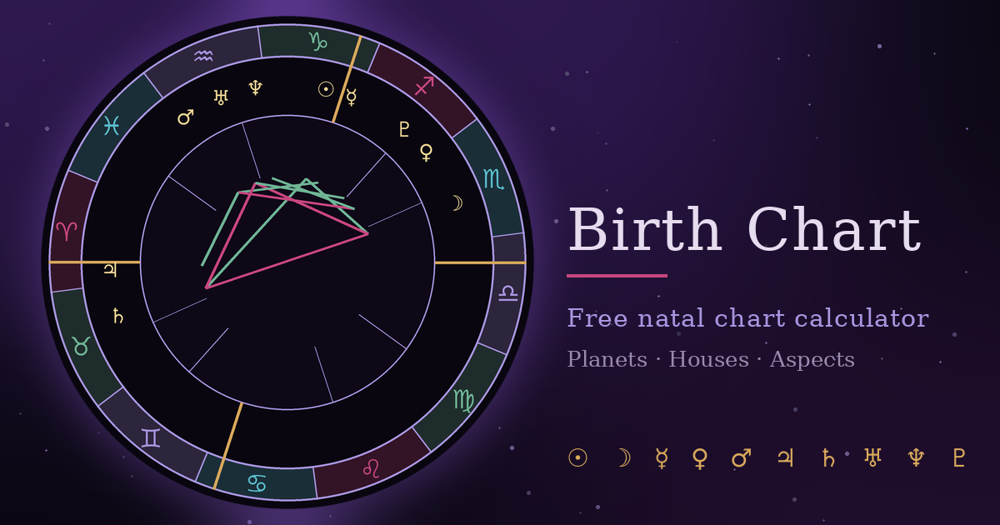

# Birth-Chart

Calculate your birth chart: planetary positions, ascendant, houses and aspects, with symbolic meanings.

Enter your date, time and place of birth to see an astrological map of the sky at the moment you were born, drawn as a classic chart wheel with the zodiac signs, houses, planets and the aspects between them.

**[🪐 Open Birth Chart](https://millaceedee.github.io/Birth-Chart/)**

## Features

- **Interactive chart wheel** with zodiac signs, houses, planets and aspect lines
- **Sun, Moon and planets** from Mercury to Pluto, plus the North Node
- **Ascendant (ASC) and Midheaven (MC)** with Placidus houses
- **Retrograde indicators** for planets in apparent backward motion
- **Aspects** between the planets, drawn inside the chart
- **Quick readings** that summarize the key placements in plain language
- **Full positions table** with sign, degree and house for every body
- **Unknown birth time mode**, which leaves out the ascendant and houses when the exact time isn't known
- **Place search** with a built-in list of cities by country, or enter your own coordinates and time zone
- **Save as SVG or PNG** to keep or share your chart
- **Bilingual support** (English and Finnish with a quick toggle)

## How It Works (Astronomical Calculations)

Birth Chart calculates everything entirely client-side in your browser. **No APIs, no servers, and no internet connection are required**, and your birth details never leave your device.

- **Planetary Positions:** Powered by [Astronomy Engine](https://github.com/cosinekitty/astronomy) by Don Cross, with sub-arcminute accuracy.
- **Houses:** Placidus house system, with the ascendant and midheaven calculated from the time and place of birth.
- **Lunar Node:** The true North Node.
- **Time Zones:** Local birth time is converted to universal time using the selected IANA time zone.

## About

Birth Chart is a personal project exploring astronomy, astrology and the symbolism people have attached to the sky for thousands of years.

The readings are symbolic and meant for reflection and curiosity, not as scientific or professional advice.

## Try it online

You can use the chart directly in your browser without installing anything.

## Source code

The source code is available in this repository. You are welcome to explore it, learn from it and build upon it under the terms of the MIT License.

## Original creator

Created by **Millaceedee** in 2026.

If you share or redistribute this project, please retain the original copyright notice and the MIT License.

## License

This project is licensed under the MIT License. See the [LICENSE](LICENSE) file for details.